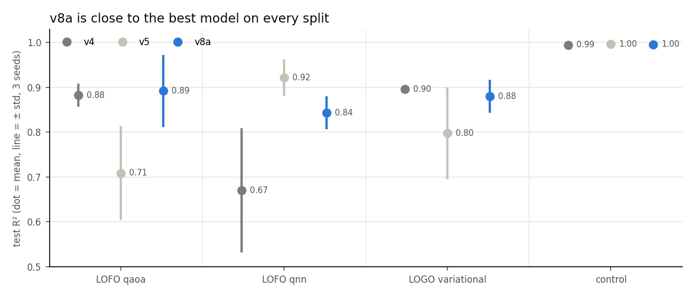
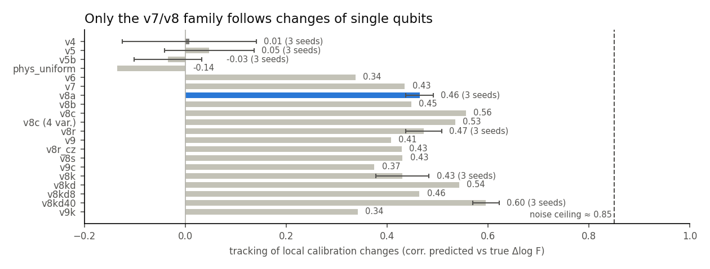
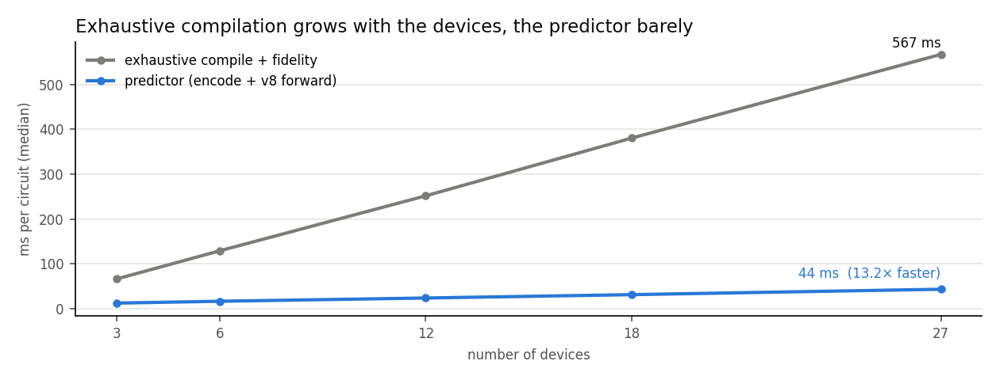

# Results — fidelity predictor study

*Generated by `evaluations/results_report.py` on 2026-10-11 08:12 UTC from the result files; do not edit by hand.*

**Main model: v8a** — v7 + loss on the true gate counts.

## Models

| Model | Idea | Status |
| --- | --- | --- |
| v4 | physics head + per-qubit attention | baseline |
| v5 | one-to-one Sinkhorn placement + chip distance | baseline |
| v5b | v5 + fixed budget, cosine LR, SWA | discarded |
| phys_uniform | v4 without placement (diagnostic) | diagnostic |
| v6 | v5 + loss on the compiler's exact layout | discarded |
| v7 | v5 + loss on used region and qubit distances | superseded |
| v8a | v7 + loss on the true gate counts | **main model** |
| v8b | v8a + calibration variants in training | discarded |
| v8c | v8a fine-tuned with a loss on the change of log F | pilot |
| v8c (4 var.) | v8c with 4 of the 8 calibration variants | test |
| v8r | v8a + routing-free flag (VF2 subgraph test) | 3 seeds running |
| v9 | v8r + per-device relative qubit features | running |
| v8r_cz | v8r + count loss weighted on cz (0.1 vs 0.01) | running |
| v8s | v8r_cz + greedy routing-cost estimate as input | running |
| v9c | v8s + relative device features (all add-ons) | running |
| v8k | v8s with a constrained CZ count (exact when no routing) | running |
| v8kd | v8k fine-tuned with the change loss on 100 calibrations per device | running |
| v8kd8 | same fine-tuning on the 8 v8b calibrations (control) | running |
| v8kd40 | v8kd with 40 epochs, also on the three held-out splits | running |
| v11 | usage-map head: CZ per coupler, r and measure per qubit | running |
| v11d40 | v11 fine-tuned with the change loss on 300 calibrations | running |
| v9k | v8k + relative device features | running |
| v9f | v8r + the add-ons kept by the v9 decision | running |

## Generalization to unseen families

Test R², mean ± std (number of seeds).

| Model | LOFO qaoa | LOFO qnn | LOGO variational | variational: qnn | control |
| --- | --- | --- | --- | --- | --- |
| v4 | 0.882 ± 0.026 (3) | 0.670 ± 0.139 (3) | 0.896 ± 0.002 (3) | 0.782 ± 0.232 (3) | 0.995 ± 0.001 (3) |
| v5 | 0.709 ± 0.105 (3) | 0.922 ± 0.040 (3) | 0.798 ± 0.103 (3) | -0.330 ± 0.864 (3) | 0.996 ± 0.000 (3) |
| v5b | 0.609 ± 0.289 (3) | 0.906 ± 0.023 (3) | 0.800 ± 0.046 (3) | -0.928 ± 0.558 (3) | 0.996 ± 0.000 (3) |
| phys_uniform | 0.739 (1) | 0.897 (1) | 0.755 (1) | -1.933 (1) | 0.994 (1) |
| v6 | 0.822 (1) | 0.720 (1) | 0.774 (1) | 0.298 (1) | 0.995 (1) |
| v7 | 0.934 (1) | 0.615 (1) | 0.830 (1) | 0.268 (1) | 0.996 (1) |
| **v8a** | 0.892 ± 0.080 (3) | 0.843 ± 0.037 (3) | 0.880 ± 0.037 (3) | 0.403 ± 0.135 (3) | 0.996 ± 0.000 (3) |
| v8b | 0.844 (1) | 0.754 (1) | 0.801 (1) | -0.676 (1) | 0.997 (1) |
| v8c | – | – | – | – | 0.996 (1) |
| v8c (4 var.) | – | – | – | – | 0.996 (1) |
| v8r | 0.861 ± 0.115 (3) | 0.898 ± 0.060 (3) | 0.914 ± 0.020 (3) | 0.916 ± 0.030 (3) | 0.996 ± 0.000 (3) |
| v9 | 0.823 (1) | 0.954 (1) | 0.945 (1) | 0.846 (1) | 0.997 (1) |
| v8r_cz | 0.918 (1) | 0.974 (1) | 0.878 (1) | 0.082 (1) | 0.996 (1) |
| v8s | 0.939 (1) | 0.958 (1) | 0.841 (1) | 0.775 (1) | 0.996 (1) |
| v9c | 0.941 (1) | 0.974 (1) | 0.937 (1) | 0.782 (1) | 0.996 (1) |
| v8k | 0.955 ± 0.043 (3) | 0.867 ± 0.067 (3) | 0.930 ± 0.010 (3) | 0.883 ± 0.126 (3) | 0.996 ± 0.000 (3) |
| v8kd | – | – | – | – | 0.996 (1) |
| v8kd8 | – | – | – | – | 0.996 (1) |
| v8kd40 | 0.965 ± 0.031 (3) | 0.854 ± 0.063 (3) | 0.918 ± 0.025 (3) | 0.854 ± 0.194 (3) | 0.996 ± 0.001 (3) |
| v11 | – | – | 0.941 (1) | 0.960 (1) | – |
| v9k | 0.946 (1) | 0.740 (1) | 0.927 (1) | 0.858 (1) | 0.996 (1) |

## Calibration changes (low-noise test)

457 unseen circuits, truth = best of 5 compilations, control models. *Local* = single qubits/couplers change (shuffle, jitter σ 0.2–0.3); *moderate* = all errors ×0.7–1.3. Relative error 1.0 = as good as predicting no change. Mean over seeds.

| Model | seeds | local: tracking | local: worst R² | local: rel. error of ΔF | local: MAE of F | moderate: R² | moderate: tracking |
| --- | --- | --- | --- | --- | --- | --- | --- |
| v4 | 3 | 0.01 | 0.409 | 1.72 | 0.037 | 0.991 | 0.98 |
| v5 | 3 | 0.05 | 0.909 | 1.05 | 0.022 | 0.994 | 0.97 |
| v5b | 3 | -0.03 | 0.949 | 0.97 | 0.023 | 0.992 | 0.90 |
| phys_uniform | 1 | -0.14 | 0.942 | 1.00 | 0.027 | 0.987 | 0.98 |
| v6 | 1 | 0.34 | 0.968 | 0.86 | 0.023 | 0.991 | 0.93 |
| v7 | 1 | 0.43 | 0.980 | 0.75 | 0.020 | 0.994 | 0.96 |
| **v8a** | 3 | 0.46 | 0.965 | 0.73 | 0.020 | 0.993 | 0.96 |
| v8b | 1 | 0.45 | 0.983 | 0.61 | 0.016 | 0.993 | 0.91 |
| v8c | 1 | 0.56 | 0.981 | 0.64 | 0.018 | 0.993 | 0.97 |
| v8c (4 var.) | 1 | 0.53 | 0.977 | 0.67 | 0.019 | 0.992 | 0.96 |
| v8r | 3 | 0.47 | 0.976 | 0.72 | 0.019 | 0.994 | 0.96 |
| v9 | 1 | 0.41 | 0.973 | 0.76 | 0.021 | 0.994 | 0.98 |
| v8r_cz | 1 | 0.43 | 0.974 | 0.74 | 0.020 | 0.994 | 0.96 |
| v8s | 1 | 0.43 | 0.979 | 0.70 | 0.019 | 0.994 | 0.96 |
| v9c | 1 | 0.37 | 0.974 | 0.75 | 0.021 | 0.994 | 0.98 |
| v8k | 3 | 0.43 | 0.977 | 0.71 | 0.019 | 0.994 | 0.96 |
| v8kd | 1 | 0.54 | 0.981 | 0.59 | 0.019 | 0.994 | 0.98 |
| v8kd8 | 1 | 0.46 | 0.979 | 0.64 | 0.019 | 0.993 | 0.94 |
| v8kd40 | 3 | 0.60 | 0.983 | 0.58 | 0.018 | 0.995 | 0.98 |
| v9k | 1 | 0.34 | 0.954 | 0.84 | 0.022 | 0.994 | 0.97 |

## Inference time vs exhaustive compilation

288 circuits, 1 thread, circuit already in memory; devices = 3 originals + calibration variants. Graph encoding 11.2 → 2.2 ms (`gsv3/fast_encoding.py`).

| Devices | Exhaustive (ms) | Predictor (ms) | Speed-up (median per circuit) |
| --- | --- | --- | --- |
| 3 | 66.7 | 12.9 | 5.4× |
| 6 | 129.3 | 17.0 | 7.8× |
| 12 | 251.8 | 24.2 | 10.7× |
| 18 | 380.4 | 31.7 | 12.2× |
| 27 | 566.7 | 43.8 | 13.2× |

## v9 decision — 2026-10-10 04:46

Rule (seed 5): keep an add-on if mean ΔR² on unseen families ≥ 0.005, no split < −0.03, Δcontrol ≥ −0.003, Δlocal tracking ≥ −0.03.

| run | LOFO qaoa | LOFO qnn | LOGO variational | control | local tracking |
| --- | --- | --- | --- | --- | --- |
| v8r | 0.743 | 0.948 | 0.919 | 0.996 | 0.47 |
| v8r_cz | 0.918 | 0.974 | 0.878 | 0.996 | 0.43 |
| v8s | 0.939 | 0.958 | 0.841 | 0.996 | 0.43 |
| v9 | 0.823 | 0.954 | 0.945 | 0.997 | 0.41 |

| add-on | test | verdict | numbers |
| --- | --- | --- | --- |
| cz-weighted count loss | v8r_cz vs v8r | drop | mean ΔR² unseen +0.053 (worst -0.041), Δcontrol -0.000, Δtracking -0.04 |
| routing-cost estimate | v8s vs v8r_cz | drop | mean ΔR² unseen -0.011 (worst -0.037), Δcontrol +0.000, Δtracking +0.00 |
| relative device features | v9 vs v8r | drop | mean ΔR² unseen +0.037 (worst +0.006), Δcontrol +0.000, Δtracking -0.06 |

**Not launched:** no add-on helps; v8r (3 seeds) stays the candidate.

Details, diagnostics and decisions: `evaluations/TODO.md`.
